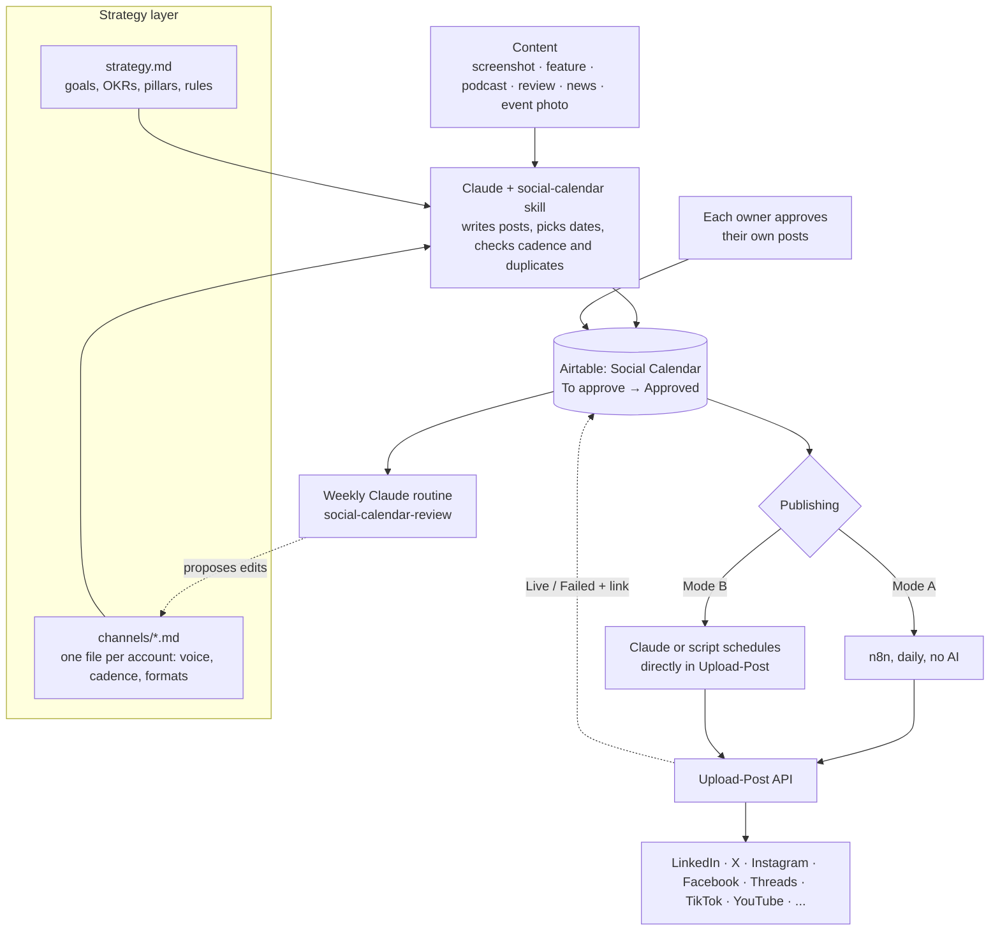

# agent-social-calendar

Run a dozen social media accounts in a couple of hours a month. You give your agent a screenshot, a feature note, a podcast clip or a customer review. It writes posts for every channel in that channel's voice, fits them into the calendar and puts them in Airtable for approval. A plain script publishes what's approved.

This is the system [Daniel Faloppa](https://github.com/faloppad) uses to run about 14 accounts for [Equidam](https://www.equidam.com) and his other companies: company pages, his own profiles, and his co-founders' and salespeople's profiles. He walked through it live at an AI meetup in Rotterdam. This repo is the open version: Claude skills, scripts, an n8n workflow, templates and a full worked example, so you can set it up with your own agent, your own Airtable and your own channels.



## How it works

1. **Strategy layer.** `strategy.md` holds goals, audiences, OKRs, content pillars and global rules. Each account gets its own `channels/<name>.md` with voice, goals, cadence, formats and example posts. They're plain text files. Keep them in a shared Drive folder and each teammate can edit their own.
2. **Generation.** You drop content into Claude: "here's the new export feature, schedule it". The `social-calendar` skill reads the strategy and channel files and checks what's already planned. If a channel is short of its 5 posts this week, a post goes on Friday. If there's too much news this week, it moves to next week. It writes one post per channel per date and creates them in Airtable.
3. **Approval.** Airtable is the shared calendar. Each person approves posts on their own profile. Nobody posts as someone else without their OK.
4. **Publishing, with no AI involved.** Approved posts go out through [Upload-Post](https://www.upload-post.com), which keeps the connections to every network alive. You pick one of two ways to drive it:
   - **Mode A, n8n:** a daily workflow that publishes what's due, updates Airtable and posts a Slack summary. This is the original setup. [`n8n/`](n8n/)
   - **Mode B, direct:** Claude, or `publish_approved.py`, hands approved posts to Upload-Post with a `scheduled_date`, and Upload-Post publishes them on time. No n8n. **If you have the tokens for it, this is the better option:** one less service to run, and you can say "schedule everything that's approved" in the same conversation. [`docs/publishing-modes.md`](docs/publishing-modes.md)
5. **Feedback loop.** A weekly Claude routine checks last week's posts against the strategy, reads metrics where it can and proposes edits to the channel files. [`docs/feedback-loop.md`](docs/feedback-loop.md)

## What one piece of content turns into

From the [Brightloop example](examples/brightloop/), a fictional startup: the founder's podcast appearance becomes 20+ posts across the company page, the founder's LinkedIn and X, the salesperson's LinkedIn, Instagram and Substack, spread over six weeks. A customer review, a feature launch and two news reactions are mixed in. See [`sample-calendar.csv`](examples/brightloop/sample-calendar.csv).

Post types that work well (more in [`post-types.md`](skills/social-calendar/references/post-types.md)):
- **Customer reviews:** screenshot a review and drop it in. These did best on LinkedIn in the original setup.
- **Feature launches:** one screenshot and one message, and the feature is scheduled on every channel.
- **Podcast and talk clips:** 20–30 shorts per episode, spread over about three months.
- **News reactions:** a screenshot of the headline plus your take.
- **Data posts:** one number or one chart, rendered from the data as a simple card.
- **Event photos.**

## Quick start

```bash
git clone https://github.com/faloppad/agent-social-calendar.git
cd agent-social-calendar
cp .env.example .env                                   # add Airtable + Upload-Post keys
cp -r templates my-strategy                            # then fill in, or let Claude interview you
python3 scripts/setup_airtable.py                      # creates Posts + Channels tables in your base
mkdir -p ~/.claude/skills && ln -s "$PWD/skills/social-calendar" ~/.claude/skills/  # install the skills
ln -s "$PWD/skills/social-calendar-review" ~/.claude/skills/
```

Then, in Claude Code:

> Here's a screenshot of a review we got today. Schedule posts about it on our channels.

The full walkthrough is in [`docs/setup.md`](docs/setup.md). The scripts use only the Python 3.9+ standard library, with nothing to install.

## What you need

| | Why | Cost |
|---|---|---|
| Claude Code (or another agent that loads `SKILL.md` files and runs Python) | Writes and schedules posts | Your plan |
| Airtable | Shared calendar and approvals | Free to start. You'll outgrow the free record limit within months |
| Upload-Post | Connections to every network, plus its own scheduler for mode B | Depends on the number of accounts. Daniel pays about 60/month for 14 |
| n8n | Mode A only | Free self-hosted |
| Slack webhook | Daily summary, manual-post pings | Free, optional |

## Repo map

```
skills/social-calendar/          main skill: content → posts → Airtable
  references/                    airtable, post types, visuals, direct publishing (mode B)
  scripts/airtable_calendar.py   list / create / update / attach / check-duplicates
  scripts/publish_approved.py    publisher for both modes (--mode now | schedule, --sync, --reconcile)
skills/social-calendar-review/   weekly feedback loop, run as a Claude routine
scripts/setup_airtable.py        creates the Airtable tables
n8n/daily-publisher.json         importable n8n workflow (mode A)
templates/                       blank strategy + channel files
examples/brightloop/             complete fictional example
docs/                            setup, data model, publishing modes, feedback loop, field notes
```

The data model (tables, fields, status values) is in [`docs/data-model.md`](docs/data-model.md). Every part of the repo follows it.

## Field notes

The short version of [`docs/lessons.md`](docs/lessons.md):
- The aim is a steady presence, not virality. Regular posting tells customers you're alive and ready to work with them.
- Spread one piece of content across every channel for months.
- Use AI to write and plan. Use scripts to publish.
- Don't build your own integrations with the social networks. They change, rate-limit and ban.
- Keep the human approval step. It's what keeps the output from being slop.

## Status

The skills, scripts and n8n workflow are tested offline against mocks. The original n8n workflow (screenshot in [`docs/img/`](docs/img/)) has run in production for months. This generic rebuild hasn't been run against live accounts yet. Run `--dry-run` first and [open an issue](https://github.com/faloppad/agent-social-calendar/issues) if something breaks.

## About

Built by [Daniel Faloppa](https://github.com/faloppad), founder of [Equidam](https://www.equidam.com), a startup valuation platform. Equidam's own social channels run on this system. If you're a founder getting ready to raise, Equidam is where you can work out and defend your valuation.

MIT licensed. Pull requests welcome, especially new post types, channel templates and connectors for metrics.
