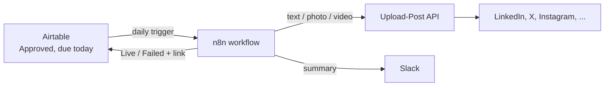
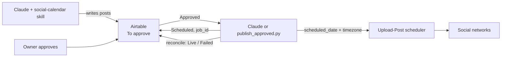

# Publishing modes

Writing posts is AI work. Publishing them is not. Once a post is approved in Airtable, something has to send it to Upload-Post at the right time and write the result back. There are two ways to do that.

## Mode A: n8n once a day (the original setup)



- n8n wakes up every morning, finds `Approved` posts dated today or earlier, sends each to Upload-Post, marks it `Live` or `Failed`, and posts a summary to Slack.
- Substack and other channels the API can't reach become `Manual`, and the post text lands in Slack for someone to paste.
- If nothing is due, Slack says so, and warns when the whole future queue is empty ("feed the agent").

Why pick it:
- Zero tokens at publish time. Nothing in the publishing path is an LLM, so it does the same thing every day.
- You can see every run in n8n's execution log and click through each step.
- It's what Daniel has been running in production.

Costs: an n8n instance (self-hosted is free; n8n Cloud is paid) and one more thing to keep running.

Setup: [`n8n/README.md`](../n8n/README.md).

## Mode B: Claude schedules directly in Upload-Post (no n8n)



Upload-Post has its own scheduler. Pass a `scheduled_date` and a `timezone` and it publishes at that time. So once posts are approved, the agent can hand them all to Upload-Post in one go and you don't need n8n.

**If you have the token budget, this is the better setup.** There is one less service to run. The schedule lives in Upload-Post, where you can see every queued post in their dashboard. You can also run it all from one conversation: "schedule everything that's approved".

Two ways to run it:

| | Claude makes the API calls | `publish_approved.py` makes the calls |
|---|---|---|
| How | Ask Claude: "schedule all approved posts in Upload-Post" | `python3 skills/social-calendar/scripts/publish_approved.py --mode schedule` |
| Cost | Tokens per post (read record, build request, write back) | Free beyond your Upload-Post plan |
| Good when | You're already in a session with Claude, or you want it to sanity-check each post before sending | Unattended runs: cron, CI, or a Claude routine that only runs the script |

Both follow the same rules (see [`skills/social-calendar/references/direct-publishing.md`](../skills/social-calendar/references/direct-publishing.md)):

- The slot is `Scheduled for` + the channel's `Post time`, in the channel's `Timezone`.
- After a successful call the post becomes `Scheduled` and the `job_id` goes into `Upload-Post ID`.
- `--sync` pushes Airtable edits (new date, new text, un-approved) to the waiting Upload-Post job.
- `--reconcile` flips `Scheduled` to `Live` or `Failed` after the slot passes.

A minimal unattended setup is one cron line or one routine, a few times a day:

```bash
python3 skills/social-calendar/scripts/publish_approved.py --sync --reconcile --mode schedule
```

plus a daily `--mode now` run to catch late approvals and ping Slack for manual channels.

## Mode B, solo: skip Airtable too

If it's only you, with no team approving posts, you can drop Airtable entirely: Claude reads your strategy files, writes the posts, shows them to you in the chat, and schedules them straight into Upload-Post after you say yes. Upload-Post's dashboard becomes the calendar.

You lose the shared approval view, the history in one table, and the cadence checks against what's already planned (Claude can partly rebuild that by listing Upload-Post's scheduled jobs). It's a fine way to start. Add Airtable when a second person needs to approve posts.

## Which one?

- **Solo, comfortable spending tokens:** Mode B, Claude makes the calls.
- **Team with approvals, want it hands-off:** Mode B with the script on a schedule.
- **Already run n8n, or want a visual, token-free pipeline:** Mode A.

Don't run both modes against the same channels. They would both pick up the same `Approved` posts.
