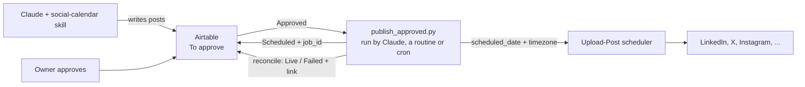

# Publishing

Writing posts is AI work. Publishing them is not. Once a post is approved in Airtable, it goes to [Upload-Post](https://www.upload-post.com) with a `scheduled_date`, and Upload-Post's own scheduler publishes it at that time. There's no server or workflow tool to run in between.



## What happens to a post

1. Claude writes it and creates it in Airtable as `To approve`.
2. The channel's owner approves it (`Approved`).
3. The publisher hands it to Upload-Post. The slot is `Scheduled for` + the channel's `Post time`, in the channel's `Timezone`. The status becomes `Scheduled` and the Upload-Post `job_id` goes into `Upload-Post ID`.
4. Upload-Post publishes it at that time. You can see every queued post in their dashboard.
5. The next reconcile run marks it `Live` with the link, or `Failed` with the reason.

If someone edits a scheduled post in Airtable (new date, new text, or sets it back to `To approve`), `--sync` updates or cancels the waiting Upload-Post job.

Substack and other channels the API can't reach become `Manual` on their due date, and the text goes to Slack for someone to paste.

## Who runs the publisher

All three options below run the same script, `skills/social-calendar/scripts/publish_approved.py`, with the same rules.

**1. Claude, in the conversation (the usual way).** After approving posts, say "schedule everything that's approved". The skill runs the script with `--dry-run`, shows you what it will send, then runs it for real. It's one conversation from content to scheduled posts.

**2. A Claude routine, hands-off.** A routine (scheduled task) that runs a few times a day and only runs the script:

```
Run: python3 skills/social-calendar/scripts/publish_approved.py --sync --reconcile --mode schedule
Then: python3 skills/social-calendar/scripts/publish_approved.py --mode now
Report failures only.
```

This picks up posts as soon as people approve them, without anyone opening Claude.

**3. cron, CI or any scheduler.** Same two commands, no tokens at all:

```bash
0 7,12,17 * * *  cd /path/to/repo && python3 skills/social-calendar/scripts/publish_approved.py --sync --reconcile --mode schedule
30 7 * * *       cd /path/to/repo && python3 skills/social-calendar/scripts/publish_approved.py --mode now
```

What the flags do:
- `--mode schedule` hands every future `Approved` post to Upload-Post.
- `--mode now` publishes `Approved` posts whose slot has already passed (approved too late), and pings Slack for `Manual` channels.
- `--sync` pushes Airtable edits to waiting jobs.
- `--reconcile` flips `Scheduled` to `Live` or `Failed`.
- `--dry-run` prints every call without sending anything. Use it first.

Claude can also make the Upload-Post calls itself instead of running the script, for example for a one-off fix. That costs tokens per post. The script does the same thing for free, so the skill prefers it. Details and the full field mapping are in [`skills/social-calendar/references/publishing.md`](../skills/social-calendar/references/publishing.md).

## Solo: skip Airtable too

If it's only you, with no team approving posts, you can drop Airtable: Claude reads your strategy files, writes the posts, shows them to you in the chat, and schedules them straight into Upload-Post when you say yes. Upload-Post's dashboard becomes the calendar.

You lose the shared approval view, the history in one table and the cadence checks against what's already planned (Claude can partly rebuild that by listing Upload-Post's scheduled jobs). It's a fine way to start. Add Airtable when a second person needs to approve posts.

## Why not n8n

The first version of this system used a daily n8n workflow: find approved posts due today, branch on text, photo or video, call Upload-Post, update Airtable, post to Slack. It worked, but Upload-Post's scheduler already does the timing, so the workflow was one more service to host and maintain for no extra benefit. The script does what that workflow did, and it lives in the same repo as the skill.

If you prefer n8n or another automation tool anyway, the rules in [`data-model.md`](data-model.md) and [`references/publishing.md`](../skills/social-calendar/references/publishing.md) are everything you need to rebuild the flow there.
