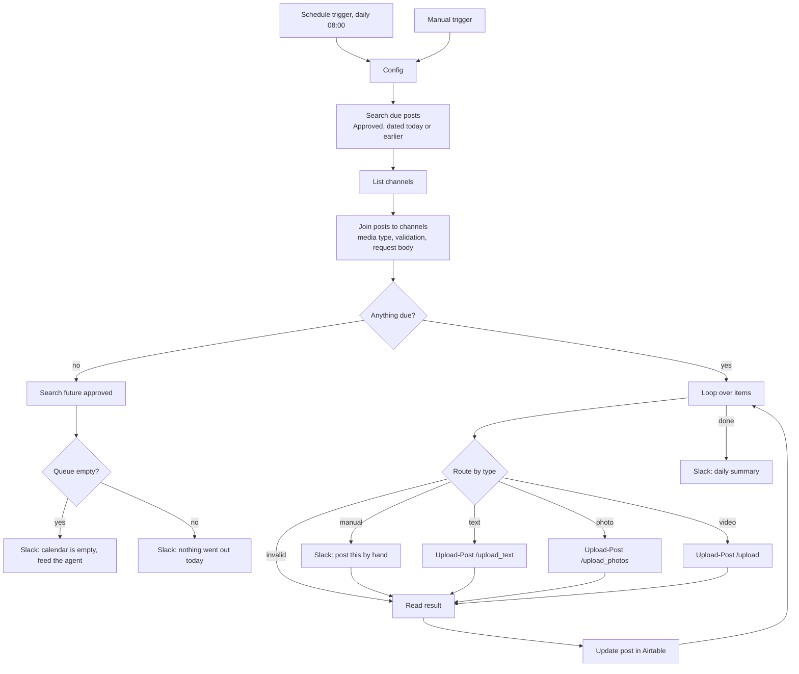
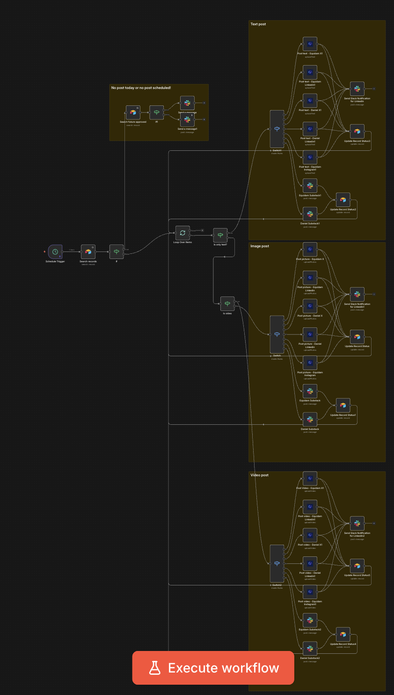

# n8n daily publisher

`daily-publisher.json` is publishing mode A. Once a day n8n reads the Airtable calendar, sends every Approved post that's due through Upload-Post, writes the result back to Airtable and tells Slack what happened. No AI runs at publish time. It's a plain script that does the same thing every morning.

Field names and status values come from [`../docs/data-model.md`](../docs/data-model.md). If you renamed a field in your base, rename it there and here.

## What it does

In words:

1. The schedule trigger fires at 08:00. The manual trigger is there for testing.
2. `Config` holds the base ID, table names, timezone and Slack webhook. It's the only node you need to edit.
3. Two Airtable searches pull the Approved posts dated today or earlier, and the whole `Channels` table.
4. A Code node matches each post to its channel, works out whether it's text, photo or video, checks the platform rules and builds the Upload-Post request.
5. If nothing is due, the workflow looks at the future queue and warns in Slack. One message if posts are queued for later days, a louder one if the calendar is empty.
6. Otherwise it loops over the posts one at a time. Each goes to the right Upload-Post endpoint, or to Slack if the channel is manual. The result goes back to Airtable as `Live`, `Failed`, `Manual` or `Scheduled`.
7. When the loop is done, one Slack message lists what went live, with links, what failed and why, and what someone has to post by hand.

## Mode A or mode B

Mode B in [`../docs/publishing-modes.md`](../docs/publishing-modes.md) removes n8n entirely. Claude or `publish_approved.py` hands each post to Upload-Post with a `scheduled_date` as soon as it's approved, and Upload-Post keeps the schedule. That's one less system to host and pay for.

Reasons to keep n8n anyway:

- It runs the same steps every day and costs no tokens. Nothing interprets anything at 8am.
- You can see it. When a post fails you open the execution, click the red node and read the response.
- Edits in Airtable count until the morning of publishing. In mode B, once a post is handed to Upload-Post, changing the text in Airtable does nothing unless you also edit the scheduled job.
- Someone on the team who will never open a terminal can still follow it, and fix it.

Pick one mode per base. Running both means every post goes out twice.

## Import

1. In n8n: **Workflows → Add workflow → ⋯ menu → Import from file**, then pick `daily-publisher.json`.
2. The Airtable and HTTP nodes will show a credential warning. Create the three credentials below and select them on each node.
3. Edit the `Config` node.
4. Test with the manual trigger, as described further down.
5. Switch the workflow to **Active**.

The workflow was built against n8n 1.x node versions: Airtable 2.1, Code 2, If 2.2, Switch 3.2, Loop Over Items 3, HTTP Request 4.2. Older instances may refuse the import. Update n8n first.

## Credentials

The JSON contains no secrets. Credential references are placeholders by name, so if you create credentials with these exact names before importing, n8n links them for you.

**Airtable PAT.** Type *Airtable Personal Access Token API*. Create the token at airtable.com/create/tokens with the scopes `data.records:read` and `data.records:write`, and give it access to your Social Calendar base. Used by `Search due posts`, `List channels`, `Search future approved` and `Update post`.

**Upload-Post API.** Type *Header Auth*.

| Field | Value |
|---|---|
| Name | `Authorization` |
| Value | `Apikey YOUR_UPLOAD_POST_KEY` |

The word `Apikey` and the space are part of the value. Get the key in the Upload-Post dashboard. Used by the three `Upload-Post:` nodes.

**Slack.** No credential. The four Slack nodes are plain HTTP requests to a Slack Incoming Webhook. Create a Slack app, turn on Incoming Webhooks, add one for your marketing channel and paste the `https://hooks.slack.com/services/...` URL into `Config → slackWebhookUrl`. Treat that URL like a password. Don't commit a workflow export that contains it.

No Slack? Select the four Slack nodes and disable them with `D`. They're also set to continue on error, so a missing webhook won't stop posts going out.

## Point it at your base

Everything lives in the `Config` node:

| Field | Default | What it is |
|---|---|---|
| `baseId` | `appXXXXXXXXXXXXXX` | Your base ID. It's the `app...` part of the base URL |
| `postsTable` | `Posts` | Table name or table ID (`tbl...`). The ID survives renames |
| `channelsTable` | `Channels` | Same |
| `timezone` | `Europe/Amsterdam` | Decides what "today" means for the searches |
| `slackWebhookUrl` | placeholder | See above |
| `usePostTime` | `false` | See "Posting at each channel's own time" |
| `onlyRecordId` | empty | Publish only this record. For testing |

The trigger hour follows the workflow timezone. Set it under **Workflow settings → Timezone** to match `Config → timezone`. On self-hosted n8n the default is `GENERIC_TIMEZONE`.

## Test it with one post

Don't test on a live calendar without `onlyRecordId`. The manual trigger publishes everything that's due, same as the schedule.

1. In Airtable, create a post for a channel you don't mind posting to. Status `Approved`, `Scheduled for` today, a short `PostContent`, no media.
2. Copy its record ID. Expand the record and take the `rec...` part from the URL.
3. Paste it into `Config → onlyRecordId`.
4. Click **Test workflow**.
5. Check the record. You want `Status = Live`, `Posted at` filled, a `Live link` and the `Upload-Post ID`. If it says `Failed`, the `Error` field has the API response.
6. Clear `onlyRecordId` before you activate the workflow.

To see what would be sent without posting anything, open `Join posts to channels` and click **Test step**. n8n runs only that node and the ones before it. Each output item shows the route it would take in `action`, any validation error in `error`, and the exact multipart body in `request.body`. Don't disable the Upload-Post nodes for this: a disabled node in n8n passes its input straight through, and the post would be marked `Live`.

## How routing works

The original workflow had a node for every account. This one has three Upload-Post nodes in total, and the `Channels` table tells them where each post goes.

For each post, `Join posts to channels` looks up the row in `Channels` whose `Name` matches the post's `Channel` exactly, ignoring case. That row supplies:

- `Platform`: sent as `platform[]`. Use Upload-Post's tokens: `linkedin`, `x`, `instagram`, `facebook`, `threads`, `tiktok`, `youtube`, `bluesky`, `pinterest`, `reddit`.
- `Upload-Post user`: sent as `user`. This is the profile name in Upload-Post that holds the connected account.
- `Target ID`: sent under the field the platform needs.

| Platform | `Target ID` becomes | Required |
|---|---|---|
| linkedin | `target_linkedin_page_id` | For company pages. Leave it empty for a personal profile |
| facebook | `facebook_page_id` | If the profile has more than one page |
| pinterest | `pinterest_board_id` | Always |
| reddit | `subreddit` | Always. Without `r/` |

- `Active`: unchecked means the post is skipped and stays `Approved`. Good for pausing an account while someone's on holiday.
- `Manual`, or platform `substack` or `other`: no API call. Slack gets the full text plus media links, and the record becomes `Manual`.

The media type comes from the `Media` attachments, as the data model says. No attachments means text, any `video/*` file means video, using the first video only, and otherwise it's photo with every image sent as `photos[]`. Upload-Post makes a carousel where the platform supports one.

Posts that can't work are marked `Failed` before any API call: a channel name that isn't in the table, a text-only post to Instagram, TikTok, YouTube or Pinterest, a channel with no Upload-Post user, Pinterest or Reddit without a Target ID.

Adding an account means adding a row to `Channels`. You don't touch n8n.

## Posting at each channel's own time

By default every due post goes out when the workflow runs, so all channels post at 08:00. Each channel's `Post time` is ignored.

Set `Config → usePostTime` to `true` and the workflow sends posts whose `Post time` is still ahead today with `scheduled_date` and the channel's `Timezone`. Upload-Post holds them until then, returns a `job_id`, and the record becomes `Scheduled`. Posts that are overdue, or whose time has passed, still go out right away. Run the trigger early, say 06:00, if you use this.

## Using the Upload-Post node instead

Upload-Post publishes its own n8n node, `n8n-nodes-upload-post`. Install it under **Settings → Community nodes**. My original workflow used it, with its *Upload Text*, *Upload Photos* and *Upload Video* operations. You can swap it in for the three HTTP nodes. Map `user`, `platform` and `title` from the item, and pass the photo or video URLs from `mediaUrls`.

I went with plain HTTP requests here because they work on any n8n instance without installing anything, and because the request is visible in the execution log.

## Troubleshooting

**Instagram fails with a text-only post.** Instagram, TikTok, YouTube and Pinterest need an image or video. The workflow catches this and marks the post `Failed` with a clear error. Fix it upstream. The skill should put these posts in `Needs media`, never `To approve`.

**A LinkedIn post went to the person's profile instead of the company page.** The channel row needs a `Target ID`, the organisation ID of the page. Upload-Post lists the pages a profile can post to at `GET /api/uploadposts/linkedin/pages`, and the dashboard shows them too. Without it, Upload-Post posts as the connected person.

**Images or videos fail with a download or 4xx error.** Airtable attachment URLs expire a few hours after they're generated. This workflow fetches the records at run time and hands the fresh URLs to Upload-Post seconds later, so it works. It breaks if you pin data in n8n and re-run hours later, or copy URLs from an old execution. Run it again from the start.

**"Channel X is not in the Channels table."** The post's `Channel` must match a `Name` in `Channels` character for character. Watch for trailing spaces and renamed accounts. `Channel` is a single select in the data model. If you made it a linked record, the post carries a record ID instead of the name and nothing will match.

**Nothing happens, but there's an Approved post for today.** Check the channel's `Active` checkbox. Then check the timezone. The search compares `Scheduled for` with today's date in `Config → timezone`, and a run at 00:30 in the wrong zone can still be "yesterday".

**The post is `Live` but there's no `Live link`.** Uploads that take longer than about a minute, usually video, finish in the background at Upload-Post. The response has a `request_id` and no URL yet. The workflow stores that ID and marks the post `Live`. Check the Upload-Post dashboard if you need the link, or if you suspect it failed after all.

**X posts turn into threads.** Upload-Post splits text over 280 characters into a thread. Write shorter posts for X. If the account has Premium, add `['x_long_text_as_post', 'true']` to the fields list in `Join posts to channels`.

**The Airtable update fails.** It's set to continue so one bad record doesn't stop the run. The summary says how many records weren't written back. The usual causes are a field name that doesn't match the data model, or a `Status` option missing from the single select.

**Posts went out twice.** Mode A and mode B were both running on the same base, or someone set a `Live` post back to `Approved`.

## Original vs this version

The original had the same skeleton: schedule, search Approved posts due today, a "nothing scheduled" branch that warns in Slack, a loop, a text/photo/video split, Upload-Post, Slack, an Airtable status update. What it didn't have was a channels table. Each media type had a Switch with one Upload-Post node per account: Equidam X, Equidam LinkedIn, Daniel X, Daniel LinkedIn, Equidam Instagram, plus a Slack node per Substack. That's around 30 nodes, and adding an account meant adding three nodes and three Switch rules.

Here the accounts are rows in `Channels`, so the canvas stays the same size whether you run two accounts or twenty. The other changes: failures are caught and written to `Error` instead of stopping the run, base and table names sit in one `Config` node, and Slack goes through a webhook, so you don't need a Slack OAuth app.
